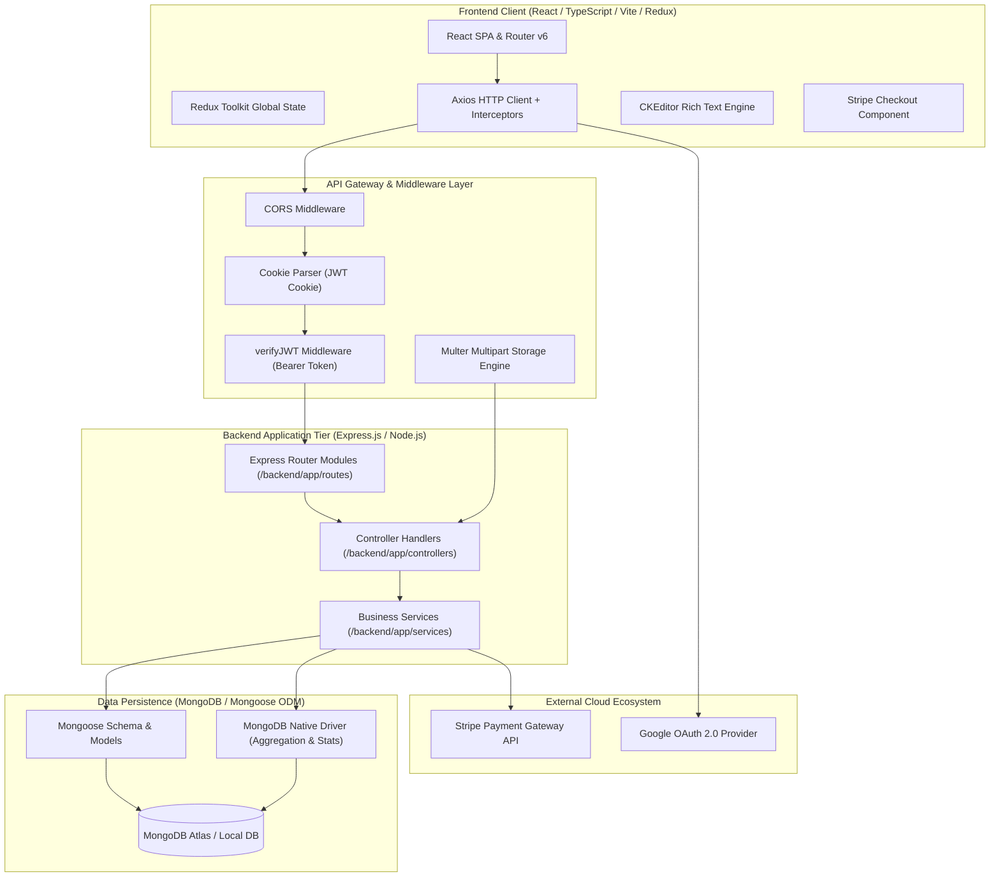
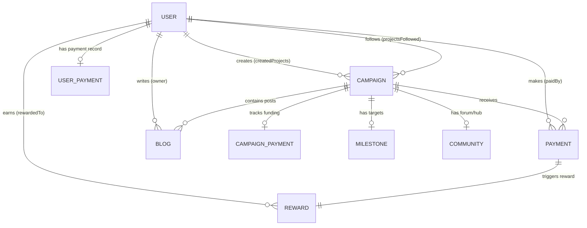
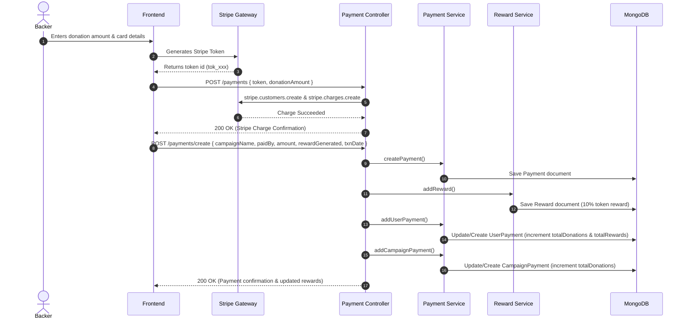

# PledgePilot: System Architecture & API Specification

Comprehensive architectural design, domain model documentation, and API endpoint reference for **PledgePilot**, a community-driven crowdfunding platform with integrated gamification, milestones, and reward distribution.

---

## Table of Contents
1. [System Architecture Overview](#1-system-architecture-overview)
2. [Architectural Layers & Design Patterns](#2-architectural-layers--design-patterns)
3. [Domain Models & Data Schemas](#3-domain-models--data-schemas)
4. [Authentication & Authorization Lifecycle](#4-authentication--authorization-lifecycle)
5. [End-to-End System Workflows](#5-end-to-end-system-workflows)
6. [Complete API Endpoints Catalog](#6-complete-api-endpoints-catalog)
   - [Authentication & Session Routes](#61-authentication--session-routes)
   - [User Management Routes](#62-user-management-routes)
   - [Campaign Management Routes](#63-campaign-management-routes)
   - [Community & Discussions Routes](#64-community--discussions-routes)
   - [Community Blog Routes](#65-community-blog-routes)
   - [Payment Processing Routes](#66-payment-processing-routes)
   - [Campaign Payments & Aggregates](#67-campaign-payments--aggregates)
   - [User Payments & Contribution History](#68-user-payments--contribution-history)
   - [Milestone Tracking Routes](#69-milestone-tracking-routes)
   - [Platform Analytics & Stats Routes](#610-platform-analytics--stats-routes)
   - [Rewards Routes](#611-rewards-routes)
7. [External Integrations](#7-external-integrations)
8. [Environment Configuration Reference](#8-environment-configuration-reference)

---

## 1. System Architecture Overview

PledgePilot utilizes a decoupled, modern **Client-Server N-Tier Architecture** centered on a RESTful Express.js service and a single-page React frontend.



---

## 2. Architectural Layers & Design Patterns

### 2.1 Layered Request-Response Flow
The backend enforces a strict unidirectional separation of concerns:
```
HTTP Request ──► server.js ──► app.js (Middleware) ──► Route Definition ──► Controller ──► Service ──► Mongoose Model ──► MongoDB
                                                                                               │
                                                                           External APIs (Stripe, OAuth)
```

1. **Server Bootstrap (`backend/server.js`)**:
   - Loads environment configuration via `dotenv`.
   - Binds dynamic ports (`PROD_PORT` or `DEV_PORT`).
   - Registers root health endpoint `GET /`.
2. **Application Configuration (`backend/app/app.js`)**:
   - Configures CORS with trusted origins (`http://localhost:3000`, `https://pledgepilot-olg9.onrender.com`).
   - Configures JSON and URL-encoded body parsing.
   - Configures static file serving for uploaded media (`/public`).
   - Attaches `cookieParser` for session cookies.
   - Connects to MongoDB via Mongoose.
   - Registers root router tree via `registerRouter(app)`.
3. **Routing Layer (`backend/app/routes/*`)**:
   - Maps URL endpoints and HTTP verbs to controller methods.
4. **Controller Layer (`backend/app/controllers/*`)**:
   - Parses HTTP parameters, request bodies, cookies, and query strings.
   - Delegates business logic to services.
   - Normalizes responses via standard response handlers:
     - `response-handler.js`: Custom handler attaching refresh tokens into secure HTTP-only cookies on `LOGIN` events.
     - `simple-response-handler.js`: Lightweight handler returning JSON payloads and uniform 500 error envelopes.
5. **Service Layer (`backend/app/services/*`)**:
   - Implements transactional logic, calculation of rewards (10% token incentive), Stripe SDK communication, and complex MongoDB aggregation pipelines.
6. **Model Layer (`backend/app/models/*`)**:
   - Defines Mongoose schemas with validations, references (`ref`), and default values.

---

## 3. Domain Models & Data Schemas



### 3.1 `User`
- **`firstName`** *(String, required)*
- **`lastName`** *(String, required)*
- **`role`** *(String, optional)*
- **`emailAddress`** *(String, required)*
- **`profilePicture`** *(Buffer, optional)*
- **`aboutMe`** *(String, optional)*
- **`projectsFollowed`** *(Array of ObjectId -> `Campaign`)*
- **`createdProjects`** *(Array of ObjectId -> `Campaign`)*
- **`accountCreationDate`** *(String, optional)*
- **`hashedPassword`** *(String, optional for OAuth users)*
- **`refreshToken`** *(String, optional)*
- **`salt`** *(String, optional)*

### 3.2 `Campaign`
- **`name`** *(String, required)*
- **`description`** *(String, required)*
- **`ownerName`** *(String, required)*
- **`owner`** *(ObjectId -> `User`)*
- **`community`**:
  - `comment`: `{ id: String, body: String, owner: { userId: String } }`
  - `blog`: `{ id: String, body: String, owner: { userId: String } }`
- **`milestone`**:
  - `target` *(String)*
  - `progress` *(String)*
- **`payments`**:
  - `count` *(String)*

### 3.3 `Payment`
- **`campaignName`** *(ObjectId -> `Campaign`)*
- **`paidBy`** *(ObjectId -> `User`)*
- **`amount`** *(Number, required)* - Dollar amount contributed.
- **`rewardGenerated`** *(Number, required)* - Gamified tokens earned (10% of amount).
- **`txnDate`** *(String, required)* - ISO date string.

### 3.4 `Reward`
- **`paymentId`** *(ObjectId -> `Payment`)*
- **`campaign`** *(ObjectId -> `Campaign`)*
- **`rewardedTo`** *(ObjectId -> `User`)*
- **`rewardAmt`** *(Number, required)*
- **`txnDate`** *(String, required)*

### 3.5 `CampaignPayment`
Aggregated campaign metrics for fast read operations:
- **`campaignId`** *(ObjectId -> `Campaign`)*
- **`users`** *(Array of ObjectId -> `User`)*
- **`totalDonations`** *(Number, default: 0)*

### 3.6 `UserPayment`
Aggregated user contribution history:
- **`userId`** *(ObjectId -> `User`)*
- **`totalDonations`** *(Number, default: 0)*
- **`totalRewards`** *(Number, default: 0)*
- **`payments`** *(Array of ObjectId -> `Payment`)*
- **`campaigns`** *(Array of ObjectId -> `Campaign`)*

### 3.7 `Milestone`
- **`campaignId`** *(ObjectId -> `Campaign`)*
- **`target`** *(Number, required)* - Financial target to unlock milestone.
- **`received`** *(Number, default: 0)* - Progress toward target.

### 3.8 `Community`
- **`communityName`** *(String, required)*
- **`campaignID`** *(Number, required)*
- **`description`** *(String, required)*
- **`numberOfPosts`** *(Number, required)*
- **`postsID`** *(Array)*
- **`commentsCount`** *(Number)*
- **`createdDateTime`** *(String, required)*
- **`comments`** *(ObjectId -> `Comment`)*
- **`blogs`** *(ObjectId -> `Blog`)*

### 3.9 `Blog`
- **`blogTitle`** *(String)*
- **`blogBody`** *(String, HTML formatted via CKEditor)*
- **`owner`** *(ObjectId -> `User`)*
- **`campaignID`** *(String)*

---

## 4. Authentication & Authorization Lifecycle

PledgePilot implements a dual-token JWT security model with rotation and cookie-isolated refresh tokens:

```mermaid
sequenceDiagram
    autonumber
    actor User as Client (Browser)
    participant Auth as Auth Controller
    participant DB as MongoDB
    participant API as Protected Route

    Note over User,Auth: 1. User Login
    User->>Auth: POST /users/login (emailAddress, password)
    Auth->>DB: Validate user & compare bcrypt hash
    DB-->>Auth: Valid User
    Auth-->>User: 200 OK + Body: { accessToken } (exp: 30s)<br/>Set-Cookie: jwt=refreshToken; HttpOnly; Max-Age=1d

    Note over User,API: 2. Accessing Protected Resource
    User->>API: GET /dashboard [Header: Authorization: Bearer <accessToken>]
    API->>API: verifyJWT validates token signature
    API-->>User: 200 OK (Protected Data)

    Note over User,Auth: 3. Token Expired -> Silent Refresh
    User->>Auth: GET /refresh [Cookie: jwt=refreshToken]
    Auth->>DB: Check if refreshToken exists for user
    Auth->>Auth: Verify refresh token signature
    Auth-->>User: 200 OK + Body: { accessToken } (fresh 30s token)

    Note over User,Auth: 4. User Logout
    User->>Auth: GET /logout [Cookie: jwt=refreshToken]
    Auth->>DB: Clear refreshToken field on User document
    Auth-->>User: 204 No Content + Clear-Cookie: jwt
```

---

## 5. End-to-End System Workflows

### 5.1 Campaign Donation & Gamified Reward Distribution


---

## 6. Complete API Endpoints Catalog

Base URL: `http://localhost:3001` (Development) / `https://pledgepilot-backend.onrender.com` (Production)

### 6.1 Authentication & Session Routes

#### `GET /refresh`
- **Description**: Issues a new short-lived JWT access token using the valid refresh token provided in HTTP-only cookie.
- **Headers**: Cookie: `jwt=<refreshToken>`
- **Response**:
  - `200 OK`:
    ```json
    {
      "accessToken": "eyJhbGciOiJIUzI1NiIsInR5cCI6IkpXVCJ9..."
    }
    ```
  - `401 Unauthorized`: Missing `jwt` cookie.
  - `403 Forbidden`: Invalid or expired refresh token.

#### `GET /logout`
- **Description**: Invalidates the active session by deleting the refresh token from the database and clearing the HTTP-only cookie.
- **Headers**: Cookie: `jwt=<refreshToken>`
- **Response**:
  - `204 No Content`: Successfully logged out.

---

### 6.2 User Management Routes

#### `POST /users/register`
- **Description**: Registers a new local user with password hashing (bcrypt, salt=10).
- **Body**:
  ```json
  {
    "firstName": "John",
    "lastName": "Doe",
    "emailAddress": "john.doe@example.com",
    "password": "Password123!"
  }
  ```
- **Response**:
  - `200 OK`: Newly created User document.

#### `POST /users/login`
- **Description**: Authenticates user credentials, sets HTTP-only refresh token cookie, and returns access token.
- **Body**:
  ```json
  {
    "emailAddress": "john.doe@example.com",
    "password": "Password123!"
  }
  ```
- **Response**:
  - `200 OK`:
    ```json
    {
      "accessToken": "eyJhbGciOi...",
      "refreshToken": "eyJhbGciOi...",
      "user": {
        "_id": "655b3f...",
        "firstName": "John",
        "lastName": "Doe",
        "emailAddress": "john.doe@example.com"
      }
    }
    ```

#### `GET /users`
- **Description**: Searches/queries users based on query parameter filters.
- **Query Params**: Optional key-value filters (e.g. `?role=donor`).
- **Response**: `200 OK` Array of User objects.

#### `GET /users/id/:id`
- **Description**: Retrieves user details by MongoDB `_id`.
- **Params**: `id` - User MongoDB ObjectId.
- **Response**: `200 OK` User object.

#### `PUT /users/id/:id`
- **Description**: Updates user profile attributes by ID.
- **Params**: `id` - User MongoDB ObjectId.
- **Body**: Partial user fields (`aboutMe`, `firstName`, `lastName`, etc.).
- **Response**: `200 OK` Updated User object.

#### `DELETE /users/id/:id`
- **Description**: Deletes a user account.
- **Params**: `id` - User MongoDB ObjectId.
- **Response**: `200 OK`: `"deleted user with id <id>"`.

#### `GET /users/email/:email`
- **Description**: Retrieves user profile populated with `projectsFollowed` and `createdProjects`.
- **Params**: `email` - User email address.
- **Response**: `200 OK` Populated User object.

#### `POST /users/email/:email`
- **Description**: Updates user profile matching email address.
- **Params**: `email` - User email address.
- **Body**: Fields to update.
- **Response**: `200 OK` Updated User object.

#### `GET /users/oauth/:email`
- **Description**: Checks if an OAuth-registered user exists by email address.
- **Params**: `email` - User email address.
- **Response**: `200 OK` Array containing user document if found.

#### `POST /users/oauth/register`
- **Description**: Registers an OAuth authenticated profile (without requiring local password hashing).
- **Body**:
  ```json
  {
    "firstName": "Jane",
    "lastName": "Doe",
    "emailAddress": "jane.doe@gmail.com",
    "accountCreationDate": "2026-10-31"
  }
  ```
- **Response**: `200 OK` Created User document.

---

### 6.3 Campaign Management Routes

#### `GET /campaigns/discover`
- **Description**: Returns all available campaigns on the platform. Supports query filtering.
- **Query Params**: Filter attributes (optional).
- **Response**: `200 OK` Array of Campaign documents.

#### `POST /campaigns/create`
- **Description**: Creates a new funding campaign.
- **Body**:
  ```json
  {
    "name": "EcoCharge Solar Hub",
    "description": "Portable solar power for camping.",
    "ownerName": "Alex Rivera",
    "owner": "655b3f...",
    "milestone": {
      "target": "10000",
      "progress": "0"
    },
    "payments": {
      "count": "0"
    }
  }
  ```
- **Response**: `200 OK` Created Campaign document.

#### `GET /campaigns/:campaignName`
- **Description**: Retrieves a campaign by its unique name, populating owner information.
- **Params**: `campaignName` - Name of the campaign.
- **Response**: `200 OK` Campaign document with populated `owner`.

#### `GET /campaigns/campaign/:campaignId`
- **Description**: Retrieves a campaign by its unique MongoDB ObjectId.
- **Params**: `campaignId` - Campaign ObjectId.
- **Response**: `200 OK` Campaign document.

#### `PATCH /campaigns/update/:campaignId`
- **Description**: Updates an existing campaign's properties.
- **Params**: `campaignId` - Campaign ObjectId.
- **Body**: Campaign fields to update.
- **Response**: `200 OK` Updated Campaign document.

#### `POST /campaigns/upload`
- **Description**: Multi-part form file upload for campaign banner/media using Multer storage engine.
- **Payload**: `multipart/form-data` with files under form key `image` or `files`.
- **Response**:
  ```json
  {
    "filename": "/images/16987654321-header.jpg"
  }
  ```

---

### 6.4 Community & Discussions Routes

#### `POST /community`
- **Description**: Instantiates a community forum attached to a campaign.
- **Body**:
  ```json
  {
    "communityName": "EcoCharge Community",
    "campaignID": 101,
    "description": "Discussion forum for EcoCharge backers",
    "numberOfPosts": 0,
    "createdDateTime": "2026-10-31T12:00:00Z"
  }
  ```
- **Response**: `200 OK` Created Community document.

#### `GET /community/:id`
- **Description**: Fetches community configuration, posts, and metrics by ID.
- **Params**: `id` - Community ObjectId.
- **Response**: `200 OK` Community document.

#### `PATCH /community/:id`
- **Description**: Updates community metadata or increments counts.
- **Params**: `id` - Community ObjectId.
- **Body**: Fields to update.
- **Response**: `200 OK` Updated Community document.

---

### 6.5 Community Blog Routes

#### `POST /blog`
- **Description**: Creates a new rich-text project update or blog post (authored via CKEditor).
- **Body**:
  ```json
  {
    "blogTitle": "Prototype Milestone Reached!",
    "blogBody": "<p>We have finished our first circuit board...</p>",
    "owner": "655b3f...",
    "campaignID": "655c8a..."
  }
  ```
- **Response**: `200 OK` Created Blog document.

#### `GET /blog/:campaignId`
- **Description**: Retrieves all blog posts associated with a specific campaign.
- **Params**: `campaignId` - Identifier of the campaign.
- **Response**:
  ```json
  [
    {
      "_id": "655d9e...",
      "blogTitle": "Prototype Milestone Reached!",
      "blogBody": "<p>We have finished...</p>",
      "campaignID": "655c8a...",
      "owner": "655b3f..."
    }
  ]
  ```

#### `PATCH /blog/:campaignId`
- **Description**: Updates blog post content.
- **Params**: `campaignId` - Blog ID.
- **Body**: `{ "blogTitle": "...", "blogBody": "..." }`
- **Response**: `200 OK` Updated Blog document.

---

### 6.6 Payment Processing Routes

#### `POST /payments`
- **Description**: Charges donor card via Stripe API using customer token.
- **Body**:
  ```json
  {
    "token": {
      "id": "tok_1O5q6t2eZvKYlo2C...",
      "email": "donor@example.com"
    },
    "donationAmount": 50
  }
  ```
- **Response**: `200 OK` Stripe Charge confirmation object.

#### `POST /payments/create`
- **Description**: Persists internal payment audit log, triggers reward calculation, and updates both user & campaign aggregate ledgers.
- **Body**:
  ```json
  {
    "campaignName": "655c8a...",
    "paidBy": "655b3f...",
    "amount": 50,
    "rewardGenerated": 5,
    "txnDate": "2026-10-31T15:30:00Z"
  }
  ```
- **Response**: `200 OK` Created Payment document.

#### `GET /payments/:payId`
- **Description**: Retrieves individual transaction record.
- **Params**: `payId` - Payment ObjectId.
- **Response**: `200 OK` Payment document.

---

### 6.7 Campaign Payments & Aggregates

#### `GET /campaignpayments/:campaignId`
- **Description**: Fetches total funding raised and backer list for a specific campaign.
- **Params**: `campaignId` - Campaign ObjectId.
- **Response**:
  ```json
  {
    "_id": "655e12...",
    "campaignId": "655c8a...",
    "users": ["655b3f...", "655b4a..."],
    "totalDonations": 1250
  }
  ```

---

### 6.8 User Payments & Contribution History

#### `GET /userpayments/:userId`
- **Description**: Fetches contribution history, total tokens/rewards accumulated, and campaigns backed by a donor.
- **Params**: `userId` - User ObjectId.
- **Response**:
  ```json
  {
    "_id": "655e99...",
    "userId": "655b3f...",
    "totalDonations": 250,
    "totalRewards": 25,
    "payments": ["655d11...", "655d22..."],
    "campaigns": ["655c8a..."]
  }
  ```

---

### 6.9 Milestone Tracking Routes

#### `GET /milestones/:campaignId`
- **Description**: Retrieves funding milestone goals and progress for a campaign.
- **Params**: `campaignId` - Campaign ObjectId.
- **Response**:
  ```json
  {
    "_id": "655f01...",
    "campaignId": "655c8a...",
    "target": 5000,
    "received": 3200
  }
  ```

#### `POST /milestones/:campaignId`
- **Description**: Sets or replaces a funding milestone for a campaign.
- **Params**: `campaignId` - Campaign ObjectId.
- **Body**:
  ```json
  {
    "campaignId": "655c8a...",
    "target": 5000,
    "received": 0
  }
  ```
- **Response**: `200 OK` Created Milestone document.

#### `DELETE /milestones/:campaignId`
- **Description**: Deletes a campaign's milestone.
- **Params**: `campaignId` - Campaign ObjectId.
- **Response**: `200 OK` Deleted document summary.

---

### 6.10 Platform Analytics & Stats Routes

#### `GET /stats`
- **Description**: Runs high-performance database-level count and summation aggregations across MongoDB collections (`campaigns`, `payments`, `rewards`) using the native MongoDB client driver.
- **Response**:
  ```json
  {
    "campaignCount": 24,
    "paymentCount": 18450,
    "rewardCount": 1845.00
  }
  ```

---

### 6.11 Rewards Routes

#### `GET /rewards` *(Defined in `backend/app/routes/reward-routes.js`)*
- **Description**: Queries all system reward distributions.
- **Response**: `200 OK` Array of Reward items.

#### `GET /rewards/:rewardId` *(Defined in `backend/app/routes/reward-routes.js`)*
- **Description**: Retrieves single reward voucher/token entry by ID.
- **Params**: `rewardId` - Reward ObjectId.
- **Response**: `200 OK` Reward item.

---

## 7. External Integrations

| Provider | Purpose | Implementation Details |
| :--- | :--- | :--- |
| **Stripe** | Credit card processing & donations | Invoked in `payment-service.js` using `stripe.charges.create` with charges calculated in cents (`amount * 100`). Secured by secret key `ADMIN_STRIPE_SECRET_KEY`. |
| **Google OAuth 2.0** | Single Sign-On (SSO) | Handled via OAuth client flow on frontend; backend records authenticated emails with dedicated endpoints `/users/oauth/:email` and `/users/oauth/register`. |
| **CKEditor 5** | Rich Text Content Editing | Integrated on frontend for Blog & Campaign updates; transmits formatted HTML directly to backend storage. |
| **Multer Engine** | Local media upload & static assets | Disk-storage engine saving media into `/frontend/public/images/` with mime-type safety checks (`jpeg`, `jpg`, `png`, `gif`, `svg`). |

---

## 8. Environment Configuration Reference

The backend relies on the following environment variables (stored in `backend/.env`):

| Variable | Description | Example / Default |
| :--- | :--- | :--- |
| `DEV_PORT` | HTTP port used in development mode | `3001` |
| `PROD_PORT` | HTTP port used in production mode | `8000` |
| `STATUS` | Deployment environment identifier | `Development` or `Production` |
| `DB_CONNECTION_STRING` | MongoDB Atlas / local connection URI | `mongodb+srv://<user>:<pwd>@cluster.mongodb.net` |
| `DB_NAME` | Target MongoDB database name | `pledgepilot` |
| `ACCESS_TOKEN_SECRET` | Secret key for signing 30-second JWT access tokens | `<crypto_random_string>` |
| `REFRESH_TOKEN_SECRET` | Secret key for signing 1-day JWT refresh tokens | `<crypto_random_string>` |
| `ADMIN_STRIPE_SECRET_KEY` | Stripe secret API key | `sk_test_...` |
| `ADMIN_STRIPE_PUBLISHABLE_KEY` | Stripe client publishable key | `pk_test_...` |
